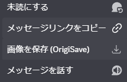
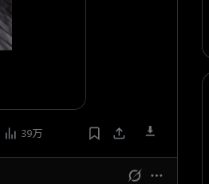

# OrigiSave - Original Media Downloader

**OrigiSave** は、X (Twitter) や Discord からオリジナル品質の画像・動画をワンクリックで保存するための直感的な Chrome 拡張機能です。

---

## 主な機能

- **X (Twitter)**: ポスト内の画像を最高画質（`name=orig`）で保存。動画も最高画質（mp4）を選択して保存。
- **Discord**: 右クリックメニューに「画像を保存 (OrigiSave)」を追加。標準より高品質なオリジナルファイルを保存。
- **直感的な操作**: すべての機能をブラウザの右クリックメニューに統合。

---

## 使い方

### Discord
メッセージを右クリックして「画像を保存 (OrigiSave)」を選択します。

### X (Twitter)
ポストの下部にあるダウンロードボタンをクリック、または画像を右クリックします。

---

## インストール

1. [Releases](https://github.com/your-username/origisave/releases) から最新の ZIP をダウンロードして解凍します。
2. Chrome で `chrome://extensions` を開きます。
3. 「デベロッパー モード」をオンにします。
4. 「展開済みアイテムを読み込む」をクリックし、解凍したフォルダを選択します。

## 設定

オプションページから、ファイル名の命名規則をカスタマイズできます。

## ライセンス

MIT ライセンス
